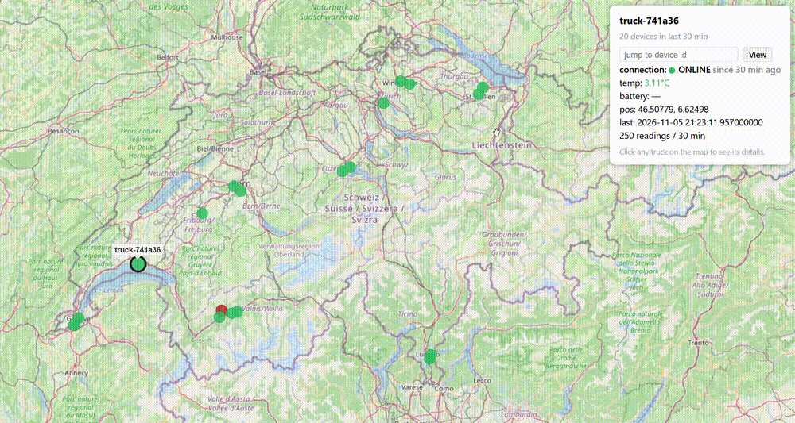
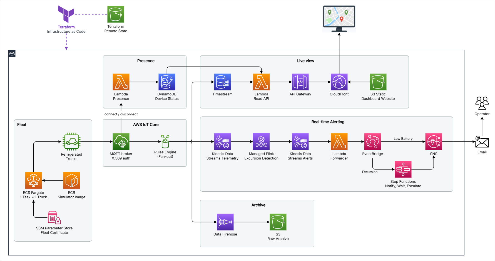

# IoT Cold-Chain Logistics Real-Time Monitoring

A real-time **cold-chain monitoring** platform on AWS for refrigerated delivery
trucks, built end-to-end with **Terraform**. Trucks publish telemetry over MQTT to
**AWS IoT Core**, and the platform is designed to scale to thousands of trucks.
The fleet is simulated on **ECS Fargate**, one task per truck. An **IoT Rules
Engine** rule fans every reading out to three independent paths:

- **Live view**: readings land in **Timestream**, served by an **API Gateway +
  Lambda** read API to a **CloudFront** dashboard that shows the whole fleet on a map.
- **Real-time detection**: **Kinesis Data Streams** feeds **Managed Service for
  Apache Flink**, which detects sustained temperature excursions and low-battery
  trucks on the move, then alerts and escalates through **EventBridge**,
  **Step Functions** and **SNS**.
- **Archive**: **Kinesis Firehose** lands every raw reading in **S3** as
  compressed, date-partitioned, KMS-encrypted objects.

Device connection state is tracked from IoT Core lifecycle events in **DynamoDB**.

<p align="center">
  
</p>

## Architecture

<p align="center">
  
</p>

## Project layout

```
terraform/              root composition + modules
  modules/
    storage/            Timestream, raw S3 bucket, DynamoDB device state
    iot_core/           device identity, telemetry fan-out rule, Firehose
    ingest/             Kinesis Data Streams
    processing/         Managed Service for Apache Flink application
    workflow/           EventBridge rules, Step Functions, SNS
    presence/           lifecycle-event rule + presence Lambda
    dashboard/          API Gateway, read Lambda, CloudFront + S3 site
    fleet/              ECS cluster/service, ECR, fleet IoT identity
flink/                  Flink SQL detectors + PyFlink loader
lambda/
  dashboard-api/        read API (Timestream + DynamoDB)
  excursion-forwarder/  Flink verdicts (Kinesis) -> EventBridge
  presence-writer/      lifecycle events -> DynamoDB
devices/
  simulator/            fleet simulator image (one Fargate task = one truck)
  phone/                optional MQTT publisher for a real device
web/                    dashboard page
```

## Main components

- **AWS IoT Core**: MQTT over TLS with X.509 certificates. Each truck may only
  publish to its own topic: the fleet policy is scoped with
  `${iot:Connection.Thing.ThingName}`. Trucks belong to one thing group.
- **ECS Fargate fleet**: each task is one truck. On start it registers its own
  `truck-<hash>` thing, joins the fleet group and starts publishing. On a
  graceful stop it deregisters. Scaling the fleet is a single `desired_count`
  change.
- **IoT Rules Engine**: one rule fans each reading out to Timestream, Kinesis and
  Firehose with no glue code. Each reading is stored at its own timestamp, so
  late or replayed readings land in the right slot.
- **Managed Flink**: event-time windowed Flink SQL. An `excursion` means the
  temperature stayed above the cargo threshold for the whole window, not a
  single spike. A `battery_low_moving` event means the battery stayed under 20%
  while the truck kept moving.
- **EventBridge + Step Functions + SNS**: an excursion starts a workflow that
  notifies operators, waits for the acknowledgement window, then escalates.
- **DynamoDB**: current online or offline state per device, from IoT Core
  lifecycle events.
- **Dashboard**: a static page on CloudFront that reads the latest position and
  status of every truck from the API. Click any truck for its readings and
  connection state.
- **Security**: a customer-managed KMS key encrypts data at rest, IAM roles are
  scoped per service, and the fleet certificate reaches the tasks through SSM
  Parameter Store. No credentials are baked into the image.

## Deploy

Prerequisites: AWS CLI with a configured profile, Terraform ≥ 1.11, Docker.

```bash
# 1. Configure inputs (never committed)
cp terraform/terraform.tfvars.example terraform/terraform.tfvars
#    set notification_email (+ region/profile if different)

# 2. Deploy the infrastructure
make deploy                 # terraform init && apply

# 3. Confirm the SNS subscription (click the link in the notification_email inbox)

# 4. Build and push the fleet simulator image
make fleet-build
```

## Test

```bash
make flink-start            # start detection (bills while running)
make fleet SIZE=20          # launch 20 simulated trucks
make fleet-status           # running / pending task counts
```

Verify each path:

- **Live view**: open `terraform -chdir=terraform output -raw dashboard_url`.
  The trucks appear on the map within a minute; click one for its details.
- **Detection**: a truck that stays above its threshold for the whole window
  turns red, an alert email arrives, and an escalation follows if it is not
  acknowledged.
- **Archive**: raw readings land in the bucket from
  `terraform -chdir=terraform output -raw raw_archive_bucket` under
  `raw/dt=YYYY-MM-DD/`.

To add a real device, see [`devices/phone/README.md`](devices/phone/README.md).

## Cleanup

```bash
make fleet-stop             # scale the fleet to 0 (tasks deregister their things)
make flink-stop             # stop Flink billing
make destroy                # terraform destroy — removes everything
```

## Remote state (S3 backend)

The project uses Terraform's **partial backend configuration**, so the bucket
name and account id stay out of the repo. Locking uses **S3-native conditional
writes** (`use_lockfile`, Terraform ≥ 1.11), so no DynamoDB lock table is needed.

| File | Committed? | Contents |
|---|---|---|
| `terraform/backend.tf` | ✅ | backend block **without** the bucket name |
| `terraform/backend.hcl` | ❌ gitignored | your real bucket name |
| `terraform/backend.hcl.example` | ✅ | placeholder template |

```bash
cd terraform
cp backend.hcl.example backend.hcl        # set your state bucket
terraform init -backend-config=backend.hcl
```
